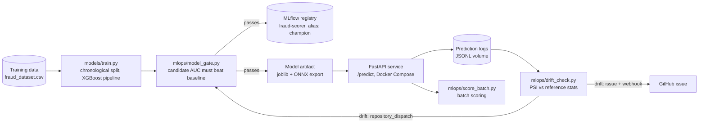

> **Roadmap:** Stage 1–2 project (production API + MLOps) in my [ML / AI Engineer Roadmap](https://github.com/NanaAkwasiAbayieBoateng/ai-ml-engineer-roadmap) — see the [P1+P2 plan](https://github.com/NanaAkwasiAbayieBoateng/ai-ml-engineer-roadmap/blob/main/projects/p1-p2-fraud-scorer.md).

# Local fraud model serving and MLOps

The project serves a gated fraud classifier with FastAPI, packages it in a
multi-stage Docker image, and deploys it to a dedicated machine using a
self-hosted GitHub Actions runner. No cloud hosting or registry is required.

## Architecture



## Local API

Build and start the API after producing a validated model and its reference
statistics:

```powershell
python -m pip install -r requirements-ci.txt
python mlops/model_gate.py
docker compose --project-name fraud-model up --build -d
```

The API is available at `http://127.0.0.1:8000`; Swagger docs are at
`/docs`, and the interactive prediction form is at `/`. `POST /predict`
(also available at `/invocations`) accepts the
following features. Numeric and categorical inputs may be null or omitted;
dates use ISO-8601 strings. Unknown fields and non-finite numbers are rejected.

```json
{
  "items_purchased": 2,
  "transaction_amount": 24.5,
  "avg_7day_spend": 18,
  "account_age_months": 8,
  "mcc_code": "Retail_A",
  "product_category": "Clothing",
  "last_login_time": "2023-01-01T10:00:00",
  "transaction_datetime": "2023-01-01T10:30:00"
}
```

Responses include fraud probability, decision, model version, request ID, and
inference latency. Structured prediction records include a UTC timestamp and
the input features. They are written to stdout and a size-limited JSONL log in
a persistent Docker volume. Treat these logs as sensitive data and restrict
access and retention. The service binds to localhost by default; set
`API_BIND_ADDRESS` only when intentionally exposing it behind suitable
network controls.

`/health` and `/ready` provide liveness and readiness checks. The Dockerfile
uses separate dependency-builder and runtime stages and runs the API as a
non-root user.

## CI/CD and local deployment

`.github/workflows/model-ci-cd.yml` runs tests on pushes and pull requests,
trains a chronologically split candidate, and requires candidate ROC-AUC to
strictly exceed `models/baseline_auc.json`. Only a passing candidate artifact
can be deployed. In CI the gate also logs the run to MLflow and registers the
winning model as `fraud-scorer`, promoted to the `champion` alias
(`mlops/model_gate.py --register`); the joblib artifact remains what the API
serves. A push to `main` (for example, a merge) builds the image on
the target machine and restarts the Docker Compose service.

To enable deployment:

1. Install Docker Engine and the Docker Compose plugin on the dedicated
   machine. Keep the API port private or bind it to localhost behind a
   controlled reverse proxy.
2. Install and register a GitHub Actions self-hosted runner on that machine
   with the custom label `fraud-model-server`; run the runner as a service.
   The workflow's deployment and drift-check jobs require this label
   and the runner must be online. The machine is only on intermittently,
   so the drift check is triggered manually (workflow_dispatch) rather
   than on a schedule.
3. Protect `main` and require the test and model-validation checks before
   merging. The runner can control Docker on the host, so only trusted,
   reviewed changes should reach its deployment job.

The Compose deployment persists prediction logs in the
`fraud-model_prediction-logs` Docker volume and uses the model artifact
produced by the gate. `MODEL_VERSION` is set to the deployed commit SHA.

The checked-in AUC is a starter threshold, not a measured production
baseline. Replace it with the current champion's holdout metric using the same
dataset version, chronological split, and metric calculation. Do not lower
the baseline simply to make a candidate pass.

## Drift monitoring and retraining trigger

The drift-check job runs a PSI check on the local machine against the deployed
model's reference feature distributions. It considers prediction logs from
the last 24 hours, requires at least 100 predictions, and flags feature PSI
of 0.2 or higher. On drift, the check opens a GitHub issue with the drifted
features, sends an alert to the configured webhook, and
dispatches `model-drift-detected`, which starts a fresh test and gated
candidate-training run.

Configure repository secret `DRIFT_ALERT_WEBHOOK_URL` with an HTTPS endpoint
that accepts a JSON POST containing `text`, `message`, and `report`. Configure
`DRIFT_DISPATCH_TOKEN` as a fine-scoped GitHub token with permission to create
repository dispatches. Without a webhook, the report remains visible in the
Actions run; without a dispatch token, drift will not trigger
retraining. A drift event never bypasses the AUC gate or merge-to-main
deployment rule.

The example retraining workflow uses `data/fraud_dataset.csv`. Production
must refresh this file from its labeled training-data source before
retraining; unlabeled production predictions are never treated as labels.
Run a drift check manually with:

```powershell
docker compose --project-name fraud-model run --rm --no-deps drift-check
```

Run tests with `pytest -q tests`. `mlops/export_onnx.py` optionally exports the
classifier for inference benchmarking; the FastAPI service uses it when
`ONNX_MODEL_PATH` points to the exported file.

## Batch scoring

Score a CSV containing the same eight input feature columns used by the API.
Additional columns (such as transaction IDs) are retained in the output, and
the model adds `fraud_probability` and `predicted_fraud` columns:

```powershell
python -m mlops.score_batch --input data\transactions.csv --output data\scored_transactions.csv
```

By default, the script loads `models/fraud_model_pipeline.joblib` and uses a
0.5 probability threshold. Override these with `--model` and `--threshold`.

## IEEE-CIS dataset (real-data training)

The checked-in dataset is a small retail-style demo set. To train on the
industry-standard IEEE-CIS Fraud Detection data instead, download it from
Kaggle (competition rules mean the CSVs cannot be committed here):

```powershell
kaggle competitions download -c ieee-fraud-detection -p data\ieee_cis
# unzip so data\ieee_cis contains train_transaction.csv and train_identity.csv
python mlops/ieee_cis.py --data-dir data/ieee_cis
```

`mlops/ieee_cis.py` merges the transaction and identity tables, builds the
feature matrix (amount/card/count/timing features plus the Vesta V-features
and categorical encodings), trains XGBoost on a chronological split, reports
ROC-AUC / PR-AUC, and logs the run to MLflow (experiment
`fraud-detection-ieee-cis`).

## Measured performance (local)

Measured 2026-11-15 on a small shared VM (1.5 vCPU), model trained by the
gate on the demo dataset (candidate ROC-AUC 0.840 vs 0.70 baseline):

- `POST /predict` server-side latency over 100 requests: **p50 13.0 ms,
  p95 17.3 ms** (latency as reported by the API itself).
- ONNX export verified against the sklearn pipeline (max probability
  error ~1.5e-07).

The service is deployed locally and intermittently for learning — bring it
up with `docker compose --project-name fraud-model up -d` on the host
machine; there is no permanent public hosting.
